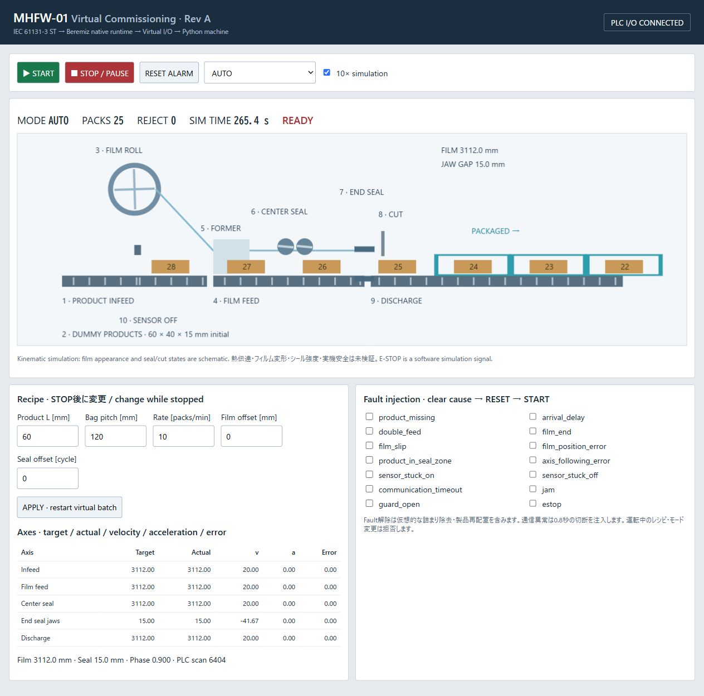
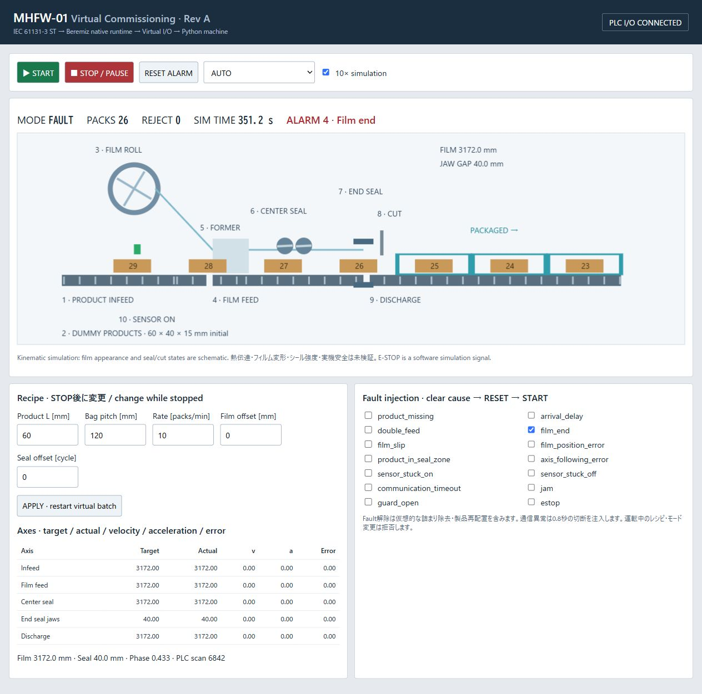

# Virtual Commissioning Rev A — verification record

Verified on Windows x64, 2026-10-11 (Japan time). This is a software commissioning result.
No hardware was purchased, connected, driven, heated, cut or safety-qualified.

## Acceptance A–J

| ID | Result | Evidence |
|---|---|---|
| A | PASS | Beremiz IDE's CLI builder + MatIEC + GCC: Successfully built; logs/build.txt |
| B | PASS | Real Beremiz 1.5.1 runtime, native DLL transfer and PLC Status Started; logs/runtime.txt |
| C | PASS | Python machine server starts; real-time HMI state snapshots |
| D | PASS | C retrieve/publish + UDP 127.0.0.1:15020 request/reply; native integration tests |
| E | PASS | Moving products, belts, film roll, rollers/jaws/cutter; hmi_running.png and changed axis/product positions |
| F | PASS | ST targets/enables actually drive five model axes, seal and cutter; native tests |
| G | PASS | Browser START/AUTO and STOP/PAUSE verified; hmi_stopped.png |
| H | PASS | ST production count matches machine acknowledgements; normal 10, reject 0; event JSONL |
| I | PASS | Browser film-end injection → ALARM 4/FAULT; reset refused while cause remained; hmi_fault.png |
| J | PASS | 24 native PLC integration cases and 4 Python/transport unit tests |

PLC IDE GUI editing/build buttons were not manually exercised. The executable CLI uses
the same Beremiz ProjectController build path and starts the actual reference runtime;
this is not an ST text-only syntax check or Python emulation.

## Normal operation and motion

Integration: 120 mm pitch, 60 mm product, 10 packs/min, 60 simulated running seconds,
**10 acknowledged packs / 0 rejects / alarm 0**. Surface speed 20 mm/s.
Accelerated tests use 200 ms machine steps with the real PLC task still 20 ms.
150 mm pitch → 25 mm/s at 10 packs/min passed. 5 packs/min → 10 mm/s passed.
SINGLE_CYCLE produced one pack then paused. MANUAL is continuous virtual jog.

Browser accelerated run reached 26 packs with zero rejects before injected film end.
Separate one-click real-time startup was verified (20 ms machine steps): STOP showed
PAUSE, 8 packs, zero rejects; logs/hmi_realtime_running.json and hmi_realtime_stopped.json.
Total displayed simulation time includes idle/paused time, so use running-time tests for rate.

End jaws use actual film position, bag phase and a closed-dwell/ramp electronic cam.
Product-in-seal-zone interlock, physical model jaw gap and package-position check are active.
This is an electronic-cam-equivalent kinematic model, not servo commissioning or thermal validation.

## Automated cases

Native ST + runtime + UDP + Python model, logs/integration_tests.txt:

1. Normal AUTO
2. Product missing
3. Product arrival delay (supply inhibited until operator clears it)
4. Film end
5. Film position error
6. Product in seal zone
7. Axis following error
8. Communication timeout and manual recovery
9. STOP, stationary film, new START
10. RESET denied with persistent film-end cause; no automatic restart
11. Bag pitch change
12. Packaging speed change
13. Double feed
14. Film slip
15. Sensor stuck ON
16. Sensor stuck OFF
17. SINGLE_CYCLE
18. Simulated guard/E-stop
19. Invalid recipe prevents start
20. MANUAL mode
21. Duplicate I/O packet does not double-count package acknowledgement
22. Stuck-ON reset denied until low sensor is observed
23. Jam
24. Replacement I/O client after timeout; fault remains latched until reset

Unit tests: axis acceleration/freeze, collision sensor, deterministic identical model steps,
and Windows UDP port-unreachable startup retry/pending transaction retention.
Unit success and native integration success are separate evidence.

## Startup / shutdown verification

scripts/start_all.ps1 builds and launches PLC/HMI with hidden helper windows.
Windows can return UDP WSAECONNRESET while the PLC port is not ready; the adapter retries
and freezes model updates until a real reply arrives. It never synthesizes PLC success.
STOP from HMI and scripts/stop_all.ps1 were exercised. The latter checks recorded process
identity/start time before ending only its own process trees. Codex's restricted process token
denied taskkill during an initial trial; normal local execution completed shutdown successfully.
No administrator installation, global execution-policy, PATH or firewall changes were made.

## Limitations / HOLD scope

- Physical machinery, heater, blade, food contact, film deformation and seal strength: **HOLD**.
- Physical I/O adapter and STM32 integration: not implemented. IOAdapter protocol is ready.
- Modbus TCP integration and CODESYS simulation: not tested; the working adapter is custom UDP.
- Native 1.6.0 Win32 build failed on dlfcn.h; verified configuration uses 1.5.1 with matching MatIEC.
- No GUI IDE button operation, safety-rated stop, hard real-time guarantee or exhaustive recipe-envelope validation.
- Cam ramps, endpoint deceleration, collision geometry and film rendering are simplified; see motion_control.md.
- MANUAL individual-axis jog, thermal control and tension physics are not implemented.
- Counters are batch-local and reset with recipe application; package event logs are saved to disk.
- One I/O client only; authentication/arbitration, full uint32-wrap handling and hostile-network testing are future work.

Next requested work can improve drive dynamics/tension/registration and transport portability,
then separately plan thermal, sanitary and safety design. Do not start the next phase automatically.

